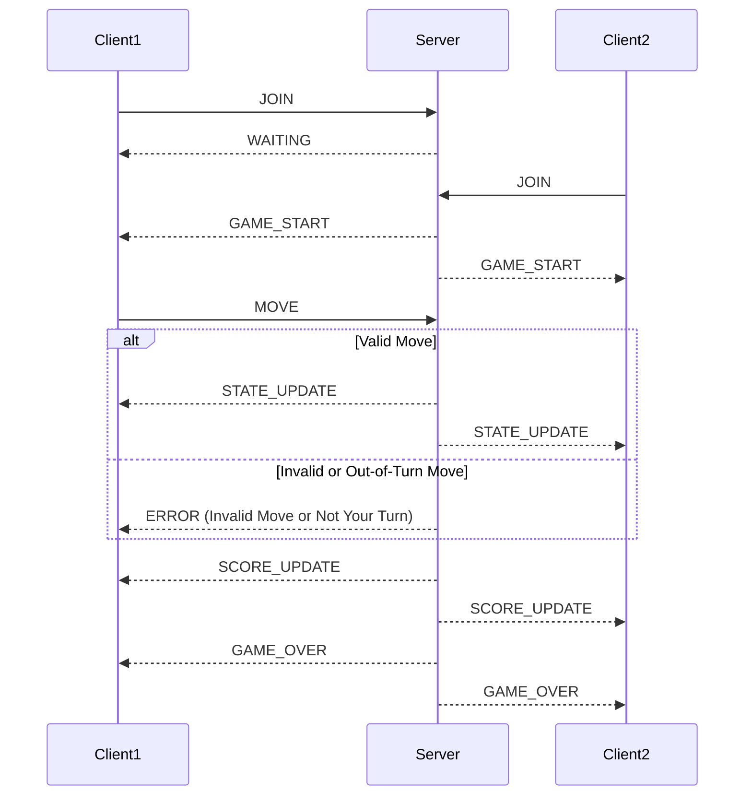

# Sprint 2 - Server Concurrency Architecture Design

## 1. Concurrency Model

The server will use a multi-threaded concurrency model. Each client that
connects to the server will be handled by its own worker thread. This allows
multiple clients to communicate with the server at the same time without one
client blocking another.

Python's threading module will be used to manage the client connections.
The server will support at least two simultaneous client connections.
## 2. Thread Safety and Locking

Since multiple client threads can access the game state at the same time,
the server will use a threading.Lock to protect shared data.

The lock will protect:
- The game board
- The current player's turn
- Player scores
- The connected client list

Before a client thread changes any shared game data, it must acquire the
lock. After the update is complete, the lock will be released. This prevents
two client threads from changing the game state at the same time and helps
prevent race conditions.

## 3. Client Connection Lifecycle

When a client connects to the server, the server accepts the connection and
creates a new worker thread for that client. The thread is responsible for
receiving and processing messages from that client.

The connection follows these steps:

1. The client connects to the server.
2. The server accepts the connection and creates a worker thread.
3. The client is added to the connected client list.
4. The client waits until another player joins if necessary.
5. Once both players are connected, the server starts the game.
6. The server receives moves from each client and verifies that it is that
   player's turn before changing the game state.
7. After a valid move, the server updates the board and broadcasts the new
   game state to both clients.
8. When a client disconnects, the server removes the client from the connected
   client list and closes the connection.

   ## 4. Client State and Turn Synchronization

The following sequence diagram shows how client moves are validated and how
the server keeps both clients synchronized.

## 5. Score and Leaderboard Synchronization

Player scores will be stored in server memory. The server will maintain a
score for each connected player and update the score when a round ends.

When a round is completed, the server will determine the winner and update
the appropriate player's score. The score update will occur while the shared
game state is protected by the threading.Lock.

After the score is updated, the server will send a SCORE_UPDATE message to
both clients. This ensures that both players receive the same score and
leaderboard information.

The score update process follows these steps:

1. The server detects that the round has ended.
2. The server determines the winner.
3. The server acquires the lock and updates the player's score.
4. The server releases the lock after the score update is complete.
5. The server broadcasts SCORE_UPDATE to both clients.
6. Both clients display the updated scores.
7. If the entire game is complete, the server broadcasts GAME_OVER to both clients.
